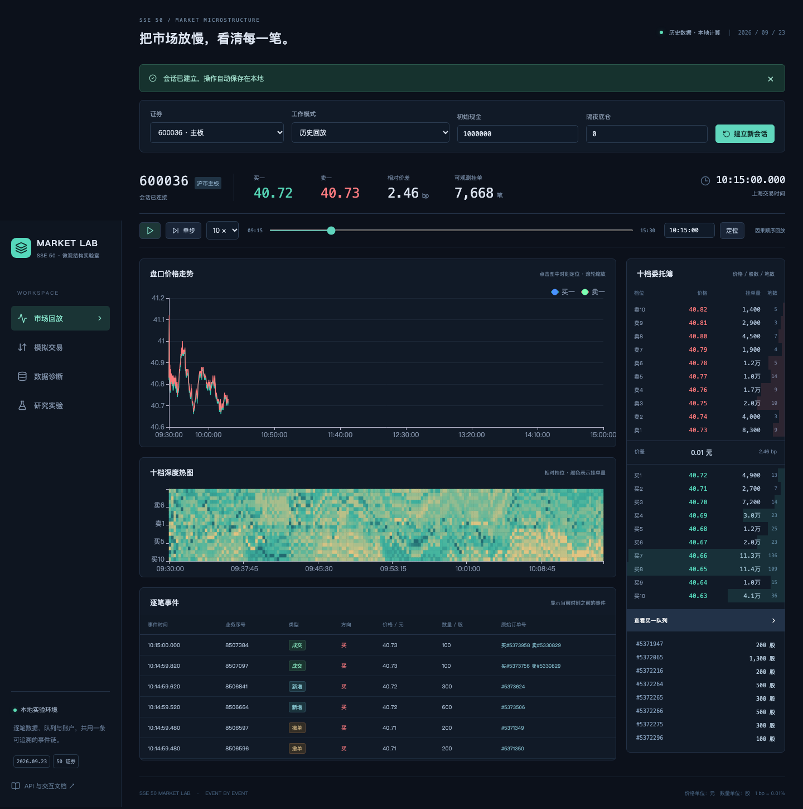

# SSE 50 Market Lab

将2026年9月23日上证50逐笔数据变成可交互的订单簿、模拟账户和微观结构实验。Rust内核处理价格时间优先、跨档、部分成交、撤单和检查点；Python负责研究与账户；React工作台展示真实十档、队列、生命周期和执行结果。



## 启动

环境：Python 3.12、[uv](https://docs.astral.sh/uv/)、Rust/Cargo；前端成品已随候选包提供，修改前端时使用Node.js 22与npm。已验证Apple Silicon、macOS 26.6。

```bash
bash scripts/start.sh
```

打开 <http://127.0.0.1:18765>。首次启动下载约226MB课程数据、校验SHA-256，并构建50股分区和五分钟检查点。输入校验值为：

```text
18c0e124a9c68eb2f77b965ca1f29c93bb30339d7db45245e1af3c0420c6c947
```

缓存与SQLite会话保存在本工程的`data/`、`work/`。端口可通过`bash scripts/start.sh 18766`调整。课程原始行情按[官方Release](https://github.com/aslan9/pku_quantllm/releases/tag/data-sse50-20260923)获取。候选包通过文件白名单构建，原始行情采用独立下载。

## 工作台

- **市场回放**：50股全日订单、成交、十档和深度热图，播放、变速、单步与定位；点击原订单号查看截至当前的生命周期，查看同价FIFO队列。
- **模拟交易**：选择历史模拟或独立交易所，设置现金和隔夜底仓；报单、部分成交、撤销余量、到期、账户及CSV导出。向后定位模拟会话会建立分支，服务重启可恢复指令。
- **独立仿真**：从空簿或历史时点开始，添加对手委托，切换连续、开收盘集合及盘后固定价格撮合。
- **数据诊断**：逐股关联、扣量、量额、集合配对和快照时间对齐；标签直接匹配与同秒状态存在性分列。
- **研究实验**：四项机制研究、执行对照、案例回放及后台重跑。完整报告在[reports/report.html](reports/report.html)。

支持限价、最优五档剩余撤销、最优五档剩余转限价、本方最优、对手方最优及盘后收盘定价。数量、价格带、价格笼子、撤单窗口和T+1采用交易日适用的上交所规则；独立仿真的阶段由操作者显式切换。

## 计算与复现

```bash
uv sync --frozen
uv run sse50 fetch
uv run sse50 prepare
uv run sse50 audit
uv run sse50 research --device auto
uv run sse50 reproduce --device mps
uv run sse50 package
```

`fetch / prepare / audit / serve / research / reproduce`接受`--data-dir`和`--config`；研究及复现接受`--device auto|mps|cuda|cpu`、`--seed`。默认配置见[configs/default.yaml](configs/default.yaml)。`auto`在Apple Silicon优先MPS，其他CUDA可用环境优先CUDA。明确的设备初始化、算子支持与显存故障会在阶段提交前完整回退到CPU。研究采用float32，资金、股数与费用以整数/定点计算。**MPS、CPU及MPS→CPU回退已验证；CUDA支持已实现，验收状态为未测试。**

交互现金默认100万元。研究账户现金1000万元，每股持有十笔目标母单的隔夜股数；母单目标5万元，按主板和科创板合法数量调整。行情100ms、报单/撤单/回报各50ms；保存零延迟和五倍压力情景。佣金万分之2.5、每订单最低5元并含交易规费，另计双边过户费万分之0.1、卖方印花税万分之5，部分成交按订单累计计费。

## 研究发现

在股票、方向、时段、价差与深度匹配后，强盘口信号的被动探针成交比例为32.59%，弱组为79.46%。强组全部起点的30秒方向变化为+0.929bp，实际成交样本按相同起点为−1.303bp。预测方向有利的时刻，订单可能留在队列里；得到成交的样本又受到成交条件筛选。

基准执行中，被动等待全任务成本5.888bp、全部完成率59.0%；信号驱动成本6.855bp、完成率72.25%。信号方案提高完成机会，成本节省相对立即主动的区间仍跨零。快速补量与密集撤单两项主检验也保留跨零区间。小成交跳价有明显的档间结构成分，后续30秒漂移区间跨零。

这些是单个交易日的条件证据；固定历史路径及共享容量假设、匹配覆盖、全部期限、压力结果和竞争解释见[方法](docs/method.md)、[研究说明](docs/findings.md)与完整报告。

## 验证与开发

```bash
uv run pytest -q
PYO3_PYTHON="$PWD/.venv/bin/python" cargo test --manifest-path crates/core/Cargo.toml
npm --prefix frontend ci
npm --prefix frontend run build
npx --prefix frontend playwright install chromium
npm --prefix frontend run test:ui
```

macOS使用uv独立Python运行Rust测试时，可先将该Python的库目录加入`DYLD_LIBRARY_PATH`：`export DYLD_LIBRARY_PATH="$(.venv/bin/python -c 'import sysconfig; print(sysconfig.get_config_var("LIBDIR"))')"`。浏览器验证默认连接18765端口。测试覆盖手算账务、FIFO与性质、撤单竞态、集合及盘后撮合、保护价、T+1、检查点及未来扰动稳定性；验证证据、性能与独立复现记录见[验收记录](docs/validation.md)。修改Rust后执行`bash scripts/build_core.sh`。

结构见[architecture.md](docs/architecture.md)，字段见[data-schema.md](docs/data-schema.md)，规则与开源参考见[references.md](docs/references.md)，接口快照见[openapi.json](docs/openapi.json)。运行服务后访问`/docs`获取交互式API文档。源码采用MIT许可，课程数据的使用遵循发布方要求。
