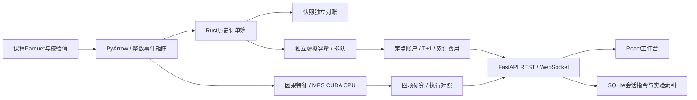

# 程序结构与接口

程序使用Rust处理确定性订单状态，Python负责数据接入、账户、会话和研究，浏览器负责操作与图表。

## 数据和内核

`data.py`将时间转换为当日毫秒、价格转换为分；事件矩阵的12列定义保存在数据清单。按证券及频道内业务序号恢复因果，保留原始时间；同一证券内时间回退时使用前缀最大时间，并计入诊断。跨证券集合竞价流有分批编排现象，原始例证见`evidence/channel_clock.json`。连续竞价的实测跨证券业务时间回退为零。共享账户的同时间回报采用证券代码及本地事件顺序作确定性排列。

Rust `Replay`按新增、撤单、成交与阶段消息更新订单簿。订单键为频道及原始订单号；证券由回放对象固定。新增消息表示入簿残量，连续主动单的先前成交由逐笔成交记录承担。集合竞价成交同时扣买卖订单，连续竞价扣被动订单，频道2301累积盘后成交量额。

订单簿采用价位有序映射、同价序列映射及订单索引。撤单直接按订单键定位。检查点保存精确序列、订单出生时间、累计量额和事件位置，恢复后的优先顺序保持一致。

## 三种模式

历史模式覆盖全日数据。历史模拟在连续竞价中运行虚拟订单，普通盘口源保持原样，虚拟订单共享独立容量账本；主动成交预占历史订单剩余量，后续历史减量先吸收这部分预占，避免重复取用。被动队列以同价既有订单为队前，真实成交流提供成交容量，FIFO模型允许队前撤单推进，保守模型仅以成交推进。

独立仿真支持空簿及历史时点初始化，后续输入由实验者控制。对手委托在连续及盘后阶段到达时参与撮合，并将成交回报交给簿内账户订单；集合阶段先收集委托。集合竞价按最大成交量、价格优先条件、最小未成交量及剩余候选中间价定价，成交统一采用该价格。盘后切换结束普通委托并释放账户资源，收盘定价订单按指定收盘价撮合。

历史模拟与独立仿真的职责分别是固定路径执行近似及可交互撮合。历史盘后数据提供成交与汇总，完整盘后队列由独立仿真演示。

## 账户与延迟

`Account`以分记账，委托冻结金额包含按保护价计算的费用预算。费用基于每个订单累计成交额计算，部分成交仅收累计费用的增量。卖出预留隔夜可卖量；当日买入增加总持仓。双边报价存在时按中间价估值，单边或空簿时采用该模式的最近成交价，初始时采用昨收价。独立仿真的图表、成交带与同价队列均来自独立订单簿。`assert_invariants()`检查资金及持仓边界。

历史模拟区分行情可见、报单到达、撤单到达与回报交付。客户在回报交付后更新账户，因而待回报的资金和股数仍被保守预留。撤单到达前继续允许成交。独立撮合即时处理，委托有效期由推进时间驱动。

## 会话与实验

SQLite保存初始会话、冻结配置及按顺序执行的用户指令，服务重启时从初始状态重放。向后查看模拟会话创建分支，原会话保留。实验接口在独立运行目录保存配置、状态和结果。

REST接口管理会话、推进、分支、报撤单、仿真阶段、对手委托、集合撮合、数据诊断、研究及CSV导出。WebSocket以会话修订号推送状态。`docs/openapi.json`是接口快照，前端`api-types.ts`由它生成。

## 计算设备

`ComputeBackend`接受`auto/mps/cuda/cpu`。Apple Silicon自动优先MPS；其他环境在CUDA可用时优先CUDA；设备初始化、算子支持或设备内存异常触发完整批次在CPU重试。计算操作返回宿主结果后，外层才提交结果。其他程序错误继续报告。

研究使用float32张量，订单与账务保持定点计算。MPS和CPU完成验证，CUDA状态为未测试。
